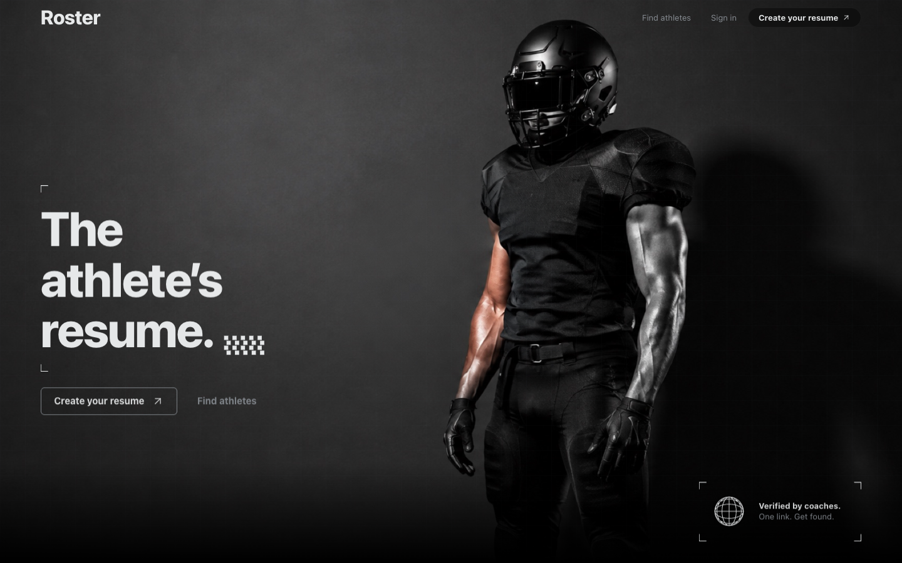
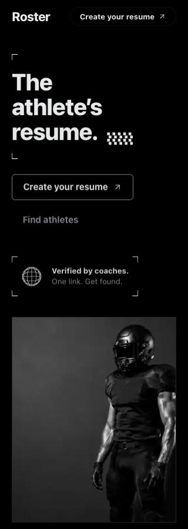
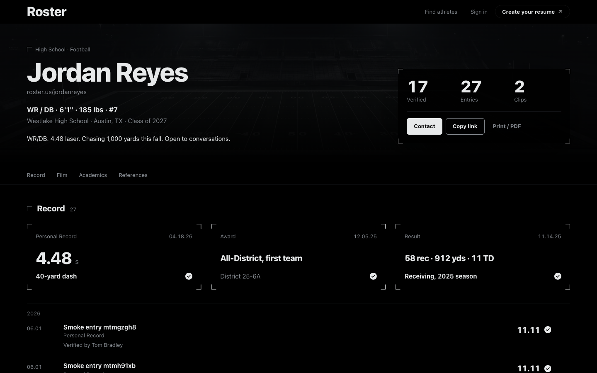
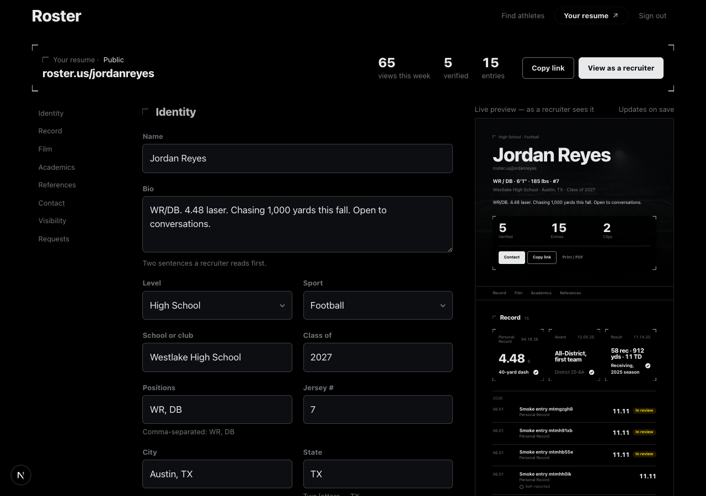
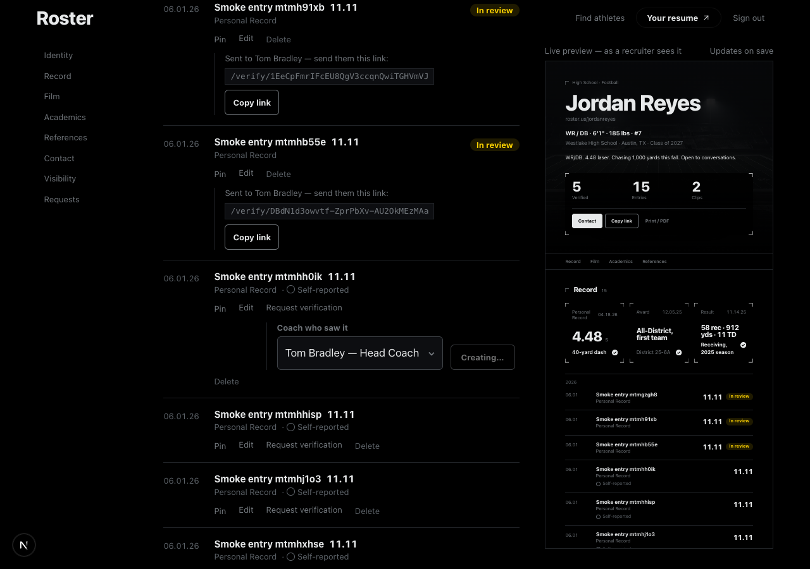
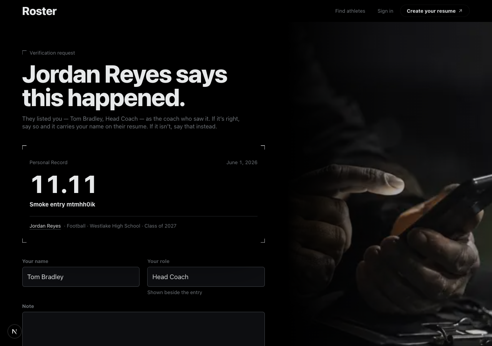
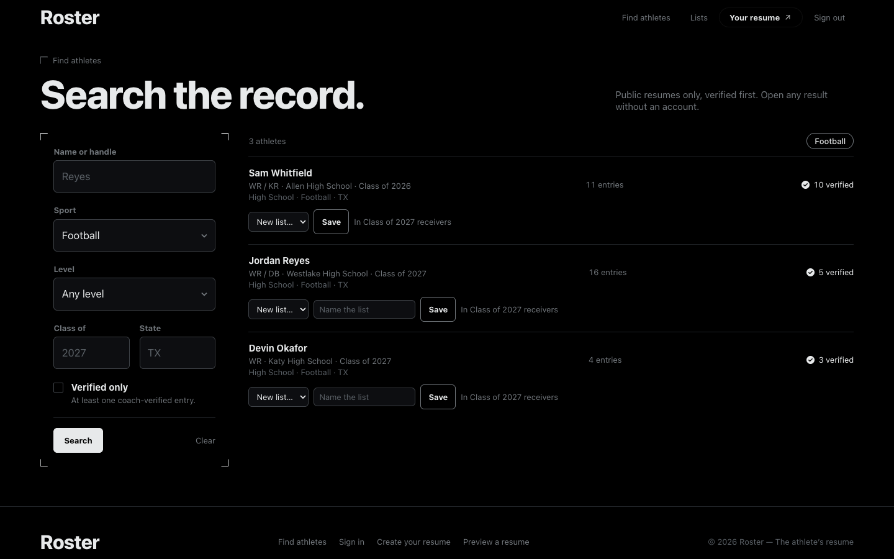
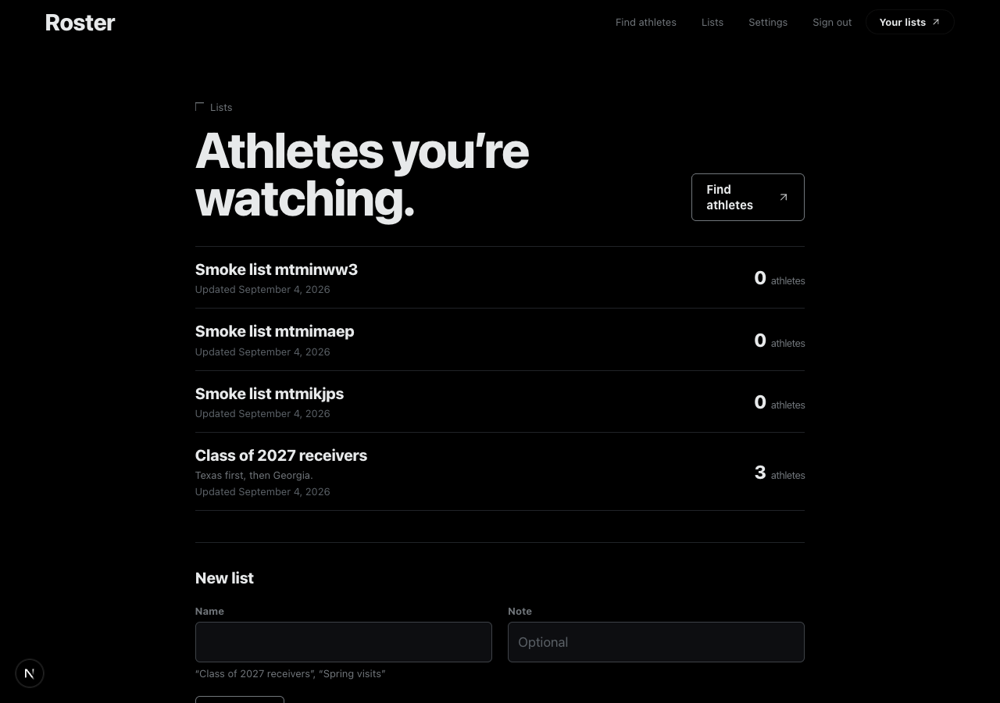
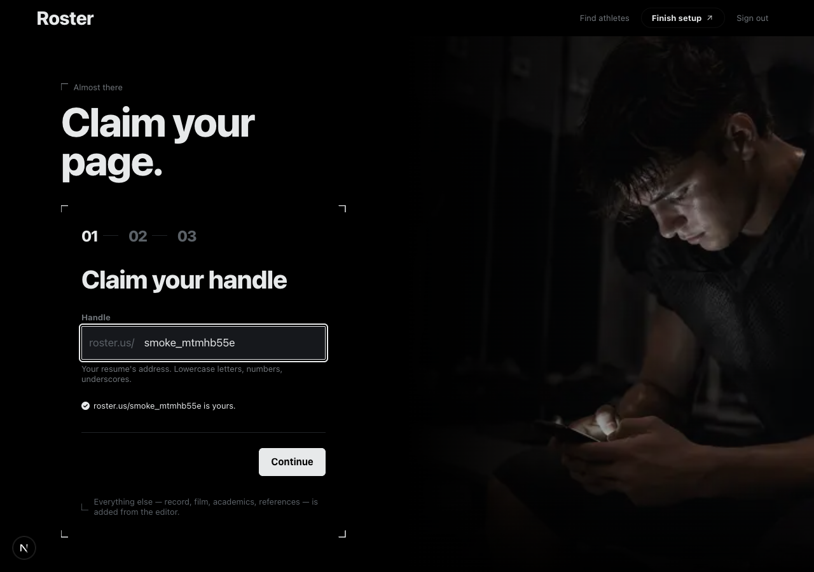
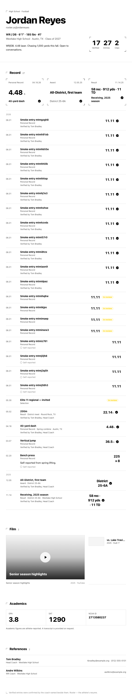

# Overnight report — the dark-identity build

Branch `feat/dark-identity`, 11 commits on top of `main`, nothing pushed.
Every milestone in [BUILD-PLAN.md](./BUILD-PLAN.md) shipped. This is what
you have, how to look at it, and what I decided without you.

## Start here

```bash
git log --oneline main..feat/dark-identity
npm run dev            # http://localhost:3000 — local mode, seeded
npm run e2e            # the whole loop in a browser, 16 steps
npm run audit          # every route × 5 widths + print, zero findings
```

Sign in as `jordanreyes@roster.local` / `roster-demo` for the athlete side,
`recruiter@roster.local` / `roster-demo` for lists. Any seeded athlete is
`<handle>@roster.local`. The data lives in `.data/roster.json` (gitignored);
`npm run seed` resets it.

## What shipped

| # | Commit | Surface |
|---|---|---|
| M0 | `c7999d0` design | Dark-only tokens, marks, buttons, fluid layout, print base |
| M1 | `6e3ed8a` data | Repository interface, local file adapter, sessions, RLS mirrored in TS, seed, tests |
| M2 | `3e016b7` landing | Landing ported into Next (live demo data), site shell, auth split layout |
| M3 | `43a304e` onboarding | Three steps, live handle check |
| M4 | `d4b6f6e` resume | The public resume as a document, print stylesheet, 404 page |
| M5 | `ff99728` editor | Workspace with share bar, rail, inline edit, live preview, verification requests |
| M6 | `a58de69` search | URL-backed filters, verified-first rows, save-to-list |
| M7 | `89c8192` verify | `/verify/[token]` — a coach answers with no account |
| M8 | `137f1a3` account | Settings, recruiter lists |
| M9 | `b03f67c` polish | Audit script, overflow/a11y/contrast/print fixes, robots, sitemap, manifest, error + loading states |
| M10 | this commit | E2E as `npm run e2e`, README, this report |

112 files changed, ~9,200 lines added. `npm run typecheck`, `npm run build`,
`npm test` (27), `npm run e2e` (16 steps), and `npm run audit` (66 checks)
are all green at HEAD.

## What it looks like

| | |
|---|---|
|  |  |
|  |  |
|  |  |
|  |  |
|  |  |

## The loop, verified in a browser

`scripts/smoke.mjs` runs against the dev server: search lists only public
athletes and filters by sport; a public resume renders; an unlisted one opens
by link but never appears in search; a private one is a 404; the editor
redirects signed-out visitors; an athlete signs in, adds an entry, sees it on
the public page, opens the live preview, creates a verification link, and
is refused when they open it themselves; signs out; a coach opens the link
with no account, verifies with a note, the link becomes single-use, and the
public resume shows "Verified by Tom Bradley"; a recruiter creates a list,
saves an athlete from search, opens the list, removes them; settings refuses
a wrong current password; a fresh sign-up walks all three onboarding steps
and lands in the editor; a reserved handle is refused before submit.

## Decisions I made alone

- **Verification is by link, not by org membership.** The schema grants
  verification authority through `memberships`; nothing in the product
  creates memberships yet. The local adapter models a `verification_requests`
  table (token, single-use, 30-day expiry) so the loop works today. Supabase
  needs that table before the flow works there — noted in the adapter.
- **`RecordEntry.verified_by`** is an optional field the local adapter
  derives from `verifications`; the Postgres view doesn't expose it yet.
- **The resume is a document, not tabs.** Sections stack, an anchor nav
  sticks under the header, and it prints. Empty sections are omitted.
- **Container queries** lay the resume out by its own width so the same
  component is correct at full page, inside the editor's preview column, and
  in print.
- **Live preview = the real component**, refreshed by each action's
  `revalidatePath`. One renderer; the preview can't drift.
- **Recruiters land on `/lists`**, not the editor; `/resume` redirects them.
  Athletes can also keep lists (a captain tracking teammates); it isn't gated.
- **Greys re-tuned for contrast**: muted `#858a90` (≈6:1), subtle `#71767b`
  (≈4.6:1). Both clear AA on black; the old subtle was 3.1:1.
- **Verified is ink, not blue.** Pending stays amber, disputed stays red.
- **`loading.tsx` only under `/search` and `/lists`.** A root one wraps every
  page in Suspense, and a streamed response returns 200 — which turned the
  private-resume 404 into a 200. The privacy model needs the real status.
- **No read cache in the local store.** Parsing the file costs ~1 ms; the
  dev server's multiple module instances make a cache untrustworthy.
- **Sample data is fictional and says so** on the landing and `/preview`.
  No user counts, no pricing, no competitor claims anywhere.

## Bugs found and fixed along the way

- Actions read absent optional form fields as `null` and tripped zod; every
  read now coerces to a string (a direct POST could have triggered it).
- The verification link lived only in the client state of the form that
  created it; the row re-rendered as "submitted" and unmounted it before
  the athlete could copy it. Pending links now render from server data.
- The coach's thank-you had the same shape: rendered server-side from the
  response timestamp now.
- Film URL helpers were exported from a client-only module and called from
  a Server Component (runtime error, invisible to the typecheck).
- A film grid's implicit track sized itself to a no-wrap title and pushed
  the page 100 px wide at 320.

## Known gaps

- **Supabase adapter is untested** against a live project. It compiles.
  Needs: a `verification_requests` table, `verified_by` on the
  `record_entries` view, and typed `recruiter_lists` (then `npm run db:types`).
- **No email.** The athlete sends the verification link themselves (by
  design for now — it's the message a coach will open). Password reset
  doesn't exist in local mode.
- **No avatars or evidence upload.** `avatar_url` and `achievement_evidence`
  exist in the schema; nothing writes them.
- **Lighthouse not run** (no Chrome install on this machine; Playwright's
  Chromium only). Bundle: the landing is the only route with `motion`
  (~30 KB gz); every other route is Server Components plus small islands.
- **The landing's demo record is Jordan Reyes**, a seeded fiction. Swap in a
  real athlete who's agreed to it when you have one.
- The old X three-column shell (`AppShell.tsx`, `icons.tsx`) was unused by
  every route and has been removed.

## Morning checklist

- [ ] `npm run dev`, click through as an athlete and as the recruiter
- [ ] Read `git log -p main..feat/dark-identity --stat` at whatever depth you like
- [ ] Merge, or tell me what to change
- [ ] When Supabase is back: fill `.env.local`, add the two schema pieces above, run `npm run db:types`, then `ROSTER_DATA=supabase npm run e2e`
